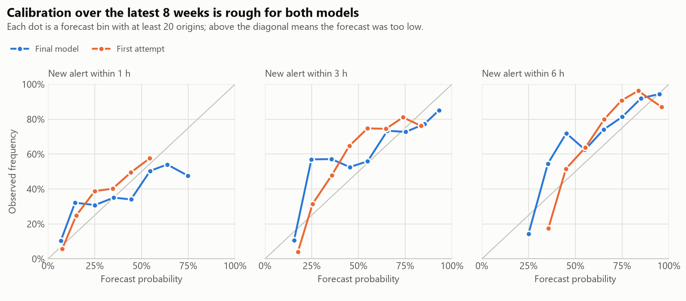

# Kyiv air raid alerts: time series analysis and a leakage-free onset forecast

This project describes four and a half years of air raid alerts in Kyiv and tests how well the start of the next alert can be forecast from alert history alone. Data runs to 12 October 2026 and the forecast is evaluated on the latest eight weeks, with automated checks that nothing from after the forecast time is used.

## Findings

- **September 2026 was the heaviest month since March 2022.** Kyiv had 190 alert starts and 243 hours under alert in September 2026, against 190 starts and 213 hours in March 2022. Since August 2026 the city has averaged 5.5 alerts a day and spent 24% of the time under alert; in earlier periods it was 1.2 to 1.9 a day and 6% to 8%.
- **The night-time pattern has gone.** From 2023 to July 2026, an hour around 01:00 to 03:00 was under alert about 11% to 15% of the time and an afternoon hour 2% to 5%. Since August 2026 every clock hour sits between 12% and 33%.
- **Alerts are about as long as before; the quiet between them collapsed.** The median alert lasts 35 minutes since August 2026, inside the 28 to 49 minute range of earlier periods. The median quiet gap fell to 1.4 hours from 5 to 11 hours.
- **A new alert within the next few hours is forecastable, but only a little better than simple rules.** On the latest eight weeks, a logistic model beats a trailing hour-of-day climatology by 5% (1 h), 13% (3 h) and 19% (6 h) in Brier score. Against the strongest simple forecast the margin is 3% to 5%, with intervals that include zero.
- **Anything anchored to the old base rate failed.** An all-history hour-of-day climatology scored 27% to 112% worse than the 28-day one, and boosted trees 18% to 86% worse.


| Period | Days | Alerts | Alerts per day | Time under alert | Median duration | 90th pct duration | Median quiet gap | Starts 23:00 to 07:00 | Burstiness |
|---|---|---|---|---|---|---|---|---|---|
| 2022 (from 28 Feb) | 307 | 592 | 1.93 | 8.4% | 49 min | 127 min | 5.3 h | 29% | 0.19 |
| 2023 to 2025 | 1,096 | 1,313 | 1.20 | 6.4% | 37 min | 188 min | 11.2 h | 40% | 0.11 |
| Jan to Jul 2026 | 212 | 336 | 1.59 | 5.8% | 28 min | 113 min | 7.0 h | 37% | 0.08 |
| Aug 2026 onward | 73 | 404 | 5.54 | 24.4% | 35 min | 149 min | 1.4 h | 34% | 0.19 |

Burstiness is the Goh-Barabási coefficient of the times between alert starts: 0 is what a constant-rate random process gives, and values towards 1 mean alerts arrive in clusters. Kyiv's alerts are mildly clustered in every period.

Since the alert-level reform of 7 September 2026, 220 finished alerts were drone-only (yellow), with a median of 34 minutes, and 25 involved a missile, ballistic or massive-drone cause (red), with a median of 47 minutes.

## Data

- **Source.** The [Kyiv Digital open API](https://kyiv.digital/open-api/air-alert/history) returns every alert start and all-clear for Kyiv City since February 2022 and is current to the minute. It needs no key.
- **Cross-check.** On every run the alert table built from the API stream is compared with the city's [weekly open-data file](https://data.kyivcity.gov.ua/dataset/statystyka-povitrianykh-tryvoh-u-misti-kyievi-dep-municipal). All 2,641 published alerts match on start and end time.
- **Scope.** Kyiv City only. It is one alert unit for the whole period, so the 2025 switch from oblast-level to raion-level alerts elsewhere in Ukraine does not break the series.
- **Time.** The API gives Kyiv wall-clock times with no offset. They are converted to UTC, with the repeated autumn hour resolved by order and the skipped spring hour moved forward. One record fell in a repeated hour.
- **Repairs.** In 2022 the stream has 47 repeated starts and 6 repeated all-clears. An all-clear closes the start immediately before it, which is the rule the published file follows. The series starts on 28 February 2022.
- **Causes.** Since the reform each alert lists causes (`drone`, `missile`, `ballistic`, `massive-drone`). The list can include causes added while the alert was running, so it is only used for alerts that have already ended.

Raw files are downloaded at run time and are not stored in the repository.

## Forecast

**Target.** At the top of each hour, if no alert is active in Kyiv: will a new alert start within the next 1, 3 or 6 hours?

Forecasting whether an alert will be *active* is mostly answered by one that is already running: in the test period, 57% of the hours with an alert at some point in the following hour already had one active. Conditioning on a quiet city removes that.

**Inputs at forecast time t.** Counts of alert starts in the last 1 h to 28 days, minutes under alert in the last 24 h and 7 days, time since the last start and the last all-clear, the duration and threat type of the last finished alert, clock hour, and the trailing hour-of-day climatology.

**Reference forecasts.** All use only origins whose outcome was known at t:

- Flat 28-day rate.
- Hour-of-day rate over 28 days, shrunk towards the flat rate. This was fixed in advance as the reference for skill.
- Hour-of-day rate over all history.
- Recent-onset rate: the 28-day rate conditional on whether an alert started in the previous H hours.

**Model.** Logistic regression, refitted every week on the previous 16 weeks.

**Protocol.** The test period is the latest eight weeks, 17 August to 12 October 2026: 940 quiet hourly origins over 57 days. Each weekly fold trains only on origins whose label window closed before the fold starts. Scores are Brier score and Brier skill, with 95% intervals from resampling whole days 1,000 times.

### How leakage is ruled out

| Risk | Guard |
|---|---|
| A feature looks past t | `test_features_do_not_change_when_the_future_is_hidden` recomputes features with every later event removed and requires identical values, on synthetic and real data |
| The check itself is blind | `test_a_feature_that_peeks_ahead_is_caught` adds a deliberately leaky feature and requires the check to flag exactly that one |
| A training label overlaps the test week | `test_training_labels_close_before_each_test_fold` |
| A reference forecast uses an outcome not yet known | `test_reference_forecasts_ignore_labels_that_have_not_closed` flips every still-open label and requires the forecast to stay the same |
| A running alert's end time or final cause list leaks | Features use starts and ends at or before t; `truncate` blanks the end and causes of an unfinished alert |
| Scaling or settings tuned on test data | The scaler is fitted on training rows only. The window, features and reference were fixed before the test run; later variations are in the sensitivity table |

### Results on the latest eight weeks

Brier score, with skill over the hour-of-day reference in brackets. Lower Brier is better. The base rate of a new alert was 33% within 1 h, 60% within 3 h and 75% within 6 h.

| Forecast | 1 h | 3 h | 6 h |
|---|---|---|---|
| Flat 28-day rate | 0.225 (+1.9%) | 0.244 (+2.1%) | 0.191 (+1.0%) |
| Hour-of-day rate, 28 days (reference) | 0.230 | 0.250 | 0.193 |
| Hour-of-day rate, all history | 0.292 (-27.4%) | 0.435 (-74.2%) | 0.410 (-112.4%) |
| Recent-onset rate, 28 days | 0.225 (+1.8%) | 0.225 (+10.1%) | 0.165 (+14.4%) |
| Logistic, all history (first attempt) | 0.210 (+8.4%) | 0.215 (+14.0%) | 0.154 (+20.2%) |
| **Logistic, last 16 weeks (final)** | 0.218 (+5.0%) | 0.217 (+13.1%) | 0.157 (+18.7%) |
| Boosted trees, last 16 weeks | 0.270 (-17.8%) | 0.362 (-45.1%) | 0.358 (-85.5%) |

Final model, with 95% intervals:

| | 1 h | 3 h | 6 h |
|---|---|---|---|
| Latest 8 weeks: skill over the hour-of-day reference | +5.0% (-0.5 to +10.4) | +13.1% (+5.6 to +20.9) | +18.7% (+10.3 to +28.2) |
| Latest 8 weeks: skill over the best simple forecast | +3.2% (-2.5 to +8.5) | +3.3% (-4.7 to +11.1) | +5.1% (-4.6 to +13.6) |
| Since 7 Sep reform: skill over the hour-of-day reference | +4.6% (-2.1 to +11.2) | +11.8% (+1.4 to +24.6) | +24.4% (+10.4 to +41.4) |
| Since 7 Sep reform: skill over the best simple forecast | +2.3% (-4.0 to +8.7) | +10.2% (+0.2 to +22.9) | +11.8% (+1.2 to +19.9) |

The "best simple forecast" is whichever reference scored best on that period, chosen after the fact, so it is a deliberately hard bar.




**Reading the results.**

- The hour-of-day reference turned out weaker than a flat rate, which fits the vanished day and night pattern. Skill over it overstates what the model adds.
- Over the full eight weeks the first attempt, trained on all history, scores slightly better than the final model at every horizon. Since the reform it does not: at 6 h it falls 6% behind the recent-onset rule, while the final model stays 12% ahead.
- The first attempt forecasts too low. Since the reform its average 6 h forecast is 74% against an observed 87%; the final model averages 82%.
- Calibration bin by bin is rough for both models, and the final model's highest 1 h forecasts were too high.
- Boosted trees averaged a 12% forecast at 1 h against an observed 33%. They cannot extrapolate beyond the alert rates seen in training.

**Sensitivity, run after the headline numbers.** Skill over the best simple forecast, by training window, with and without the climatology input:

| Model | 8 wk, 1 h | 8 wk, 3 h | 8 wk, 6 h | Reform, 1 h | Reform, 3 h | Reform, 6 h |
|---|---|---|---|---|---|---|
| Last 8 weeks | +3.1% | +0.9% | -6.8% | +0.4% | +6.6% | +4.6% |
| Last 16 weeks | +3.4% | +3.6% | +5.8% | +2.7% | +9.8% | +12.5% |
| Last 16 weeks + climatology (final) | +3.2% | +3.3% | +5.1% | +2.3% | +10.2% | +11.8% |
| Last 32 weeks | +5.8% | +3.6% | +1.4% | +4.8% | +8.8% | +2.6% |
| All history | +6.6% | +4.3% | +6.9% | +1.7% | +0.8% | -6.1% |

The 16- and 32-week windows stay positive in every cell; the shortest and the longest do not. The climatology input makes no real difference at 16 weeks and hurts at 8 weeks and on all history (full table in `outputs/tables/sensitivity.csv`).

## Limits

- One city, eight weeks, and a test period that sits inside a surge. The intervals are wide and most margins over the best simple forecast include zero.
- The alert-level reform is five weeks old; any conclusion about yellow and red alerts rests on 25 red-type alerts.
- Alerts are a response to an adversary. A pattern that holds for eight weeks can end overnight, and the model only adapts after the change shows up in the data.
- Hourly origins hide anything faster than an hour, including how alerts spread between regions.
- The forecast uses alert history only. No text, launch reports or weather.

## Reproduce

```
uv sync
uv run pytest
uv run python -m airalerts.run --as-of 2026-10-12T18:00:00Z --sensitivity
```

`--as-of` discards everything after the given UTC time, so the command reproduces the numbers above from a fresh download. Without it, the run uses all data available at download time. Outputs go to `outputs/`: `metrics.json`, `tables/` and `figures/`.

## Layout

```
src/airalerts/
  data.py       download, clean, cross-check -> alert table in UTC
  describe.py   descriptive tables and figures
  grid.py       as-of features and labels on a time grid
  baselines.py  reference forecasts
  model.py      logistic and boosted estimators
  evaluate.py   walk-forward folds, scores, day-block bootstrap
  report.py     evaluation figures
  run.py        entry point
  telegram.py   backfill of a public Telegram channel (for the text experiment)
tests/          data cleaning and leakage tests
outputs/        metrics, tables and figures from the run above
```

`outputs/metrics_v0.json` is the first attempt as recorded before any changes (git tag `v0`).
