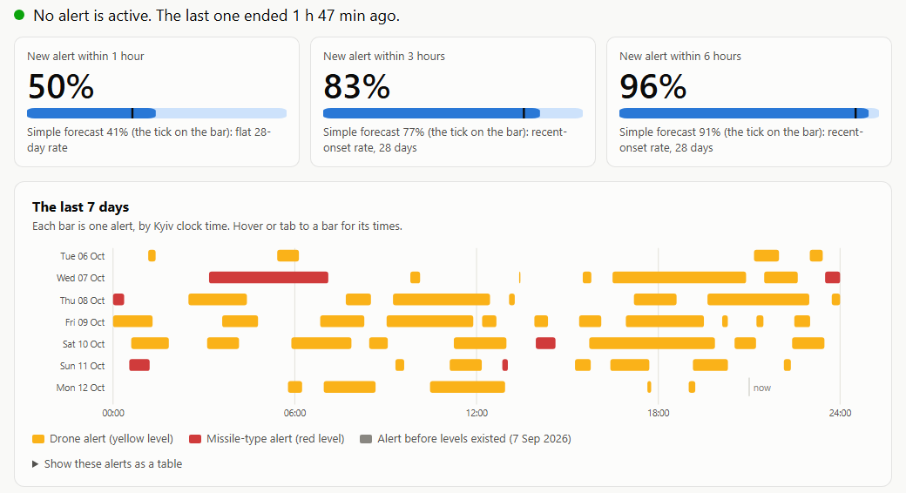
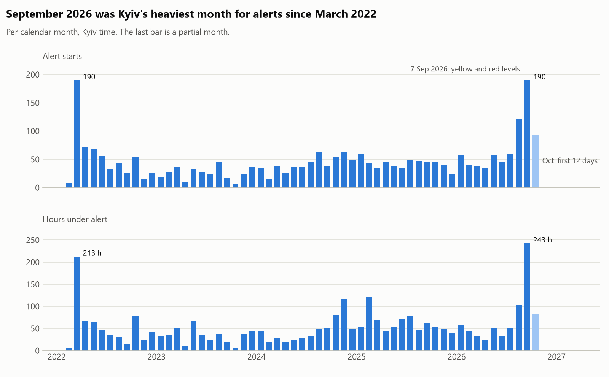
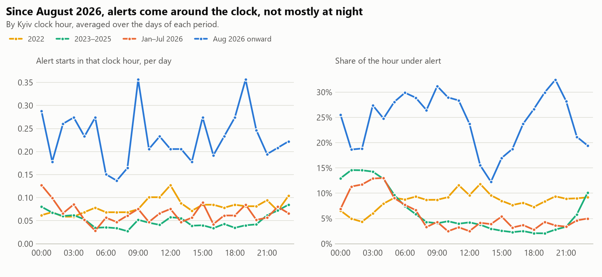
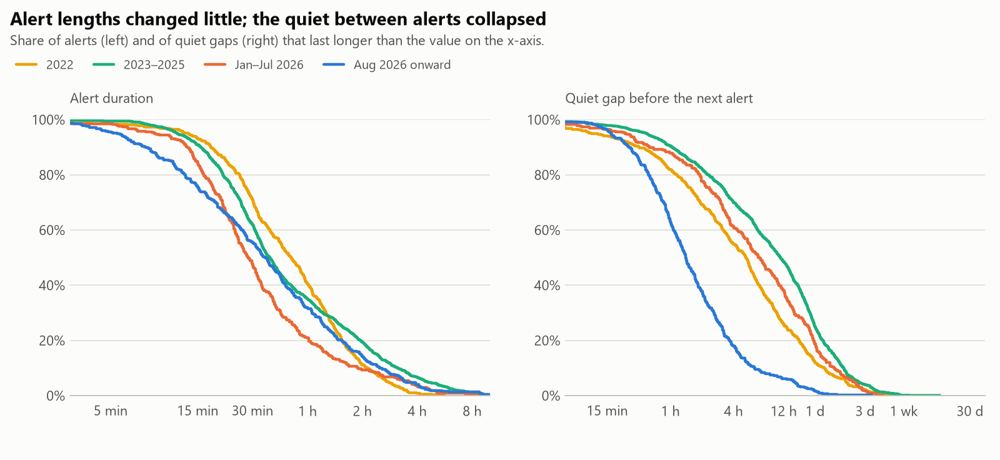
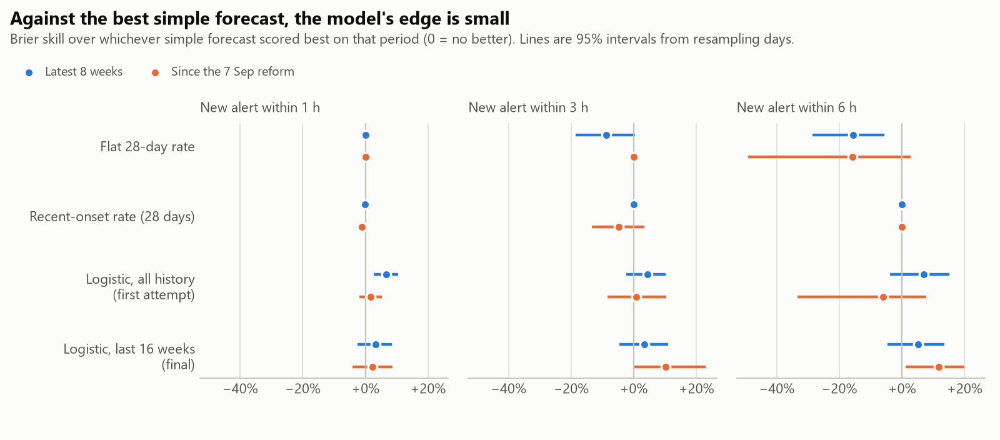
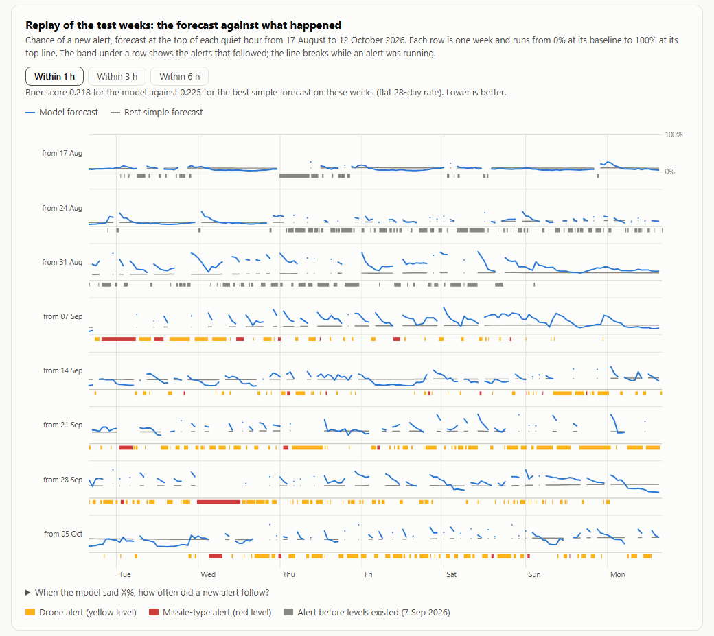

# Kyiv air raid alert forecast

From alert history alone, it estimates the chance that a new alert starts in Kyiv within 1, 3 or 6 hours.



*12 October 2026, 21:00 Kyiv time: big numbers are the model, ticks the best simple forecast.*

## It answers one question in a quiet city and another during an alert

| City | Question | Answer |
|---|---|---|
| Quiet | Will a new alert start within 1, 3 or 6 hours? | A probability per horizon |
| Alert running | How much longer will it last? | An estimate with an 80% interval |

*The city's state decides which forecast applies.*

## September 2026 was the heaviest month since March 2022



*Top: alert starts per month. Bottom: hours under alert.*

- September 2026: 190 alert starts, 243 hours under alert.
- Since August: 5.5 alerts a day, against 1.2 to 1.9 before.

## Since August 2026, alerts come around the clock



*One line per period, by Kyiv clock hour.*

- From 2023 to July 2026, alerts clustered in the small hours.
- Since August, every clock hour is under alert 12% to 33% of the time.

## Alerts are as long as before, but the quiet between them collapsed



*Share of alerts (left) and quiet gaps (right) lasting longer than the x-value.*

- Median alert: 35 minutes, inside the earlier range of 28 to 49.
- Median quiet gap: 1.4 hours, down from 5 to 11.

## Against the best simple forecast, the model's edge is small



*Dots right of zero beat the best simple forecast; lines are 95% intervals.*

| New alert within | Model | Best simple forecast | Edge | 95% interval |
|---|---|---|---|---|
| 1 hour | 0.218 | 0.225 | +3.2% | -2.5% to +8.5% |
| 3 hours | 0.217 | 0.225 | +3.3% | -4.7% to +11.1% |
| 6 hours | 0.157 | 0.165 | +5.1% | -4.6% to +13.6% |

- Brier scores on 940 quiet hours, 17 August to 12 October 2026; lower is better.
- The edge is small and its interval includes zero.
- Since the 7 September reform: +10% at 3 hours, +12% at 6 hours.

## Every test-week forecast can be replayed against what happened



*Blue: model. Grey: best simple forecast. Band: the alerts that followed.*

- Interactive in [outputs/page.html](outputs/page.html), with tabs for 3 and 6 hours.

## It runs with three commands

```
uv sync
uv run python -m airalerts.now     # the forecast right now
uv run python -m airalerts.run     # rebuild tables, figures and the page
```

*`airalerts.now` output; during an alert it shows the time likely to remain.*

```
Kyiv City at 2026-10-12 21:00 Kyiv time
No alert is active. The last one ended 1 h 47 min ago.

New alert within    model   simple  best simple forecast
1 hour                50%      41%  flat 28-day rate
3 hours               83%      77%  recent-onset rate, 28 days
6 hours               96%      91%  recent-onset rate, 28 days
```

<details><summary>Reproduce and test</summary>

```
uv run python -m airalerts.run --as-of 2026-10-12T18:00:00Z --sensitivity
uv run pytest
```

</details>

## Nothing from after the forecast time is used

| Risk | Check |
|---|---|
| An input looks ahead | Hide the future, recompute, compare |
| The check is blind | A planted leaky feature must be caught |
| Live and backtest disagree | Both must give the same number |

*Each row is a test; details in [docs/method.md](docs/method.md).*

## Two results did not hold up, and the project changed both times

| Step | What happened |
|---|---|
| First attempt | Logistic regression on all history: +8% to +20% over an hour-of-day reference |
| Final model | A flat rate beat that reference; now 16 weeks of data, scored against the best simple forecast |
| Text experiment | Air Force channel posts add about 4% at 1 hour |
| Trees correction | "Failed outright" was mostly a calibration wrapper: 0.270 with it at 1 hour, 0.250 without |
| Live tools | Live forecast, remaining-time estimate, status page |

*In the order of the git history.*

## It is one city, eight weeks and a small edge

- One city and eight test weeks inside a surge: wide intervals.
- The reform is five weeks old; red-alert conclusions rest on 25 alerts.
- The model adapts only after a change appears.

**What's next**

- Parse threat type, direction and target from each post with an LLM.
- Recalibrate; bin by bin, calibration is rough.
- Tune the boosted trees and the remaining-time estimate.

## The project was built in conversation with an AI assistant

| Part of the conversation | Log |
|---|---|
| Research into existing work | not added yet |
| Plan and first build | not added yet |
| Final model and text experiment | not added yet |
| Review follow-up | not added yet |

*Exported logs go in [conversation/](conversation/).*

## Read more

- [docs/method.md](docs/method.md): data, model, leakage checks.
- [docs/results.md](docs/results.md): every table, the corrections, the limits.
- [REFLECTION.txt](REFLECTION.txt): what went wrong.
