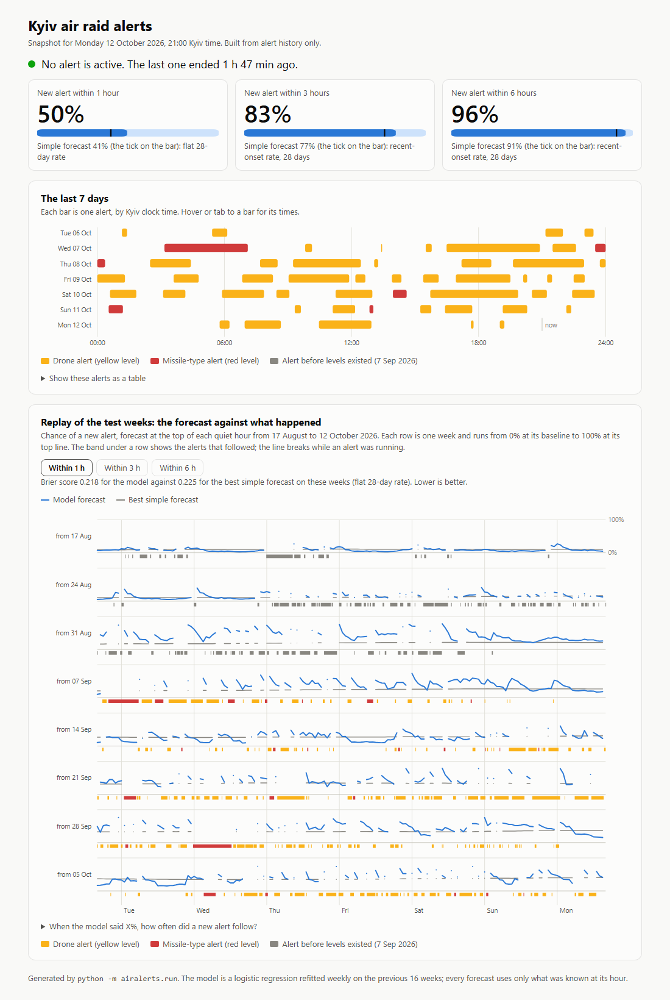

# Kyiv air raid alert forecast

A small Python project that describes Kyiv's air raid alerts since 2022 and forecasts, from alert history
alone, the chance that a new alert starts within 1, 3 or 6 hours, tested on the latest eight weeks with
checks that nothing from after the forecast time is used.



| New alert within | Model | Best simple forecast | Model's edge | 95% interval |
|---|---|---|---|---|
| 1 hour | 0.218 | 0.225 | +3.2% | -2.5% to +8.5% |
| 3 hours | 0.217 | 0.225 | +3.3% | -4.7% to +11.1% |
| 6 hours | 0.157 | 0.165 | +5.1% | -4.6% to +13.6% |

Brier scores (lower is better) on 940 quiet hours from 17 August to 12 October 2026. The best simple
forecast is whichever simple rule scored best on those weeks, picked afterwards, so it is a hard bar.
The model's edge is small and its interval includes zero. Since the alert-level reform of 7 September
the edge is +10% at 3 hours and +12% at 6 hours.

## Use it

```
uv sync
uv run python -m airalerts.now     # the forecast right now, in the terminal
uv run python -m airalerts.run     # rebuild every table and figure, and outputs/page.html
uv run pytest                      # 30 tests, including the leakage checks
```

`airalerts.now` downloads the current data and prints something like this:

```
Kyiv City at 2026-10-12 21:00 Kyiv time
No alert is active. The last one ended 1 h 47 min ago.

New alert within    model   simple  best simple forecast
1 hour                50%      41%  flat 28-day rate
3 hours               83%      77%  recent-onset rate, 28 days
6 hours               96%      91%  recent-onset rate, 28 days
```

While an alert is running it prints how much longer the alert is likely to last instead. Add
`--as-of 2026-10-12T18:00:00Z` to either command to work from a past instant; nothing after it is used.

[`outputs/page.html`](outputs/page.html) is the page in the screenshot: one self-contained file, written
by `airalerts.run`, that opens in any browser without a server.

## What the data shows

- **September 2026 was the heaviest month since March 2022**: 190 alert starts and 243 hours under alert.
  Since August the city has averaged 5.5 alerts a day, against 1.2 to 1.9 in earlier periods.
- **The night-time pattern has gone.** From 2023 to July 2026 alerts were concentrated in the small
  hours. Since August every clock hour is under alert 12% to 33% of the time.
- **Alerts are about as long as before; the quiet between them collapsed.** The median alert lasts
  35 minutes. The median quiet gap fell to 1.4 hours from 5 to 11 hours.

## What the forecast can and cannot do

- **Alert history gives a small edge over simple rules** (the table above), clearer since the reform.
- **Long history and boosted trees did not help.** An all-history hour-of-day rate scored 27% to 112%
  worse than a 28-day one, and boosted trees 9% to 22% worse.
- **Air Force channel text adds about 4% at one hour** and nothing measurable at 3 or 6 hours.
- **For a running alert, minutes elapsed help a little.** The 80% interval for the time remaining covered
  the truth 75% of the time, against 62% when elapsed time is ignored. The middle estimate is still off
  by about 70 minutes on average.

## How it is kept honest

- Every input at time t is computed from alert starts and ends at or before t. Tests recompute each
  feature, estimate and page element with the future hidden or altered and require identical output.
- A deliberately leaky feature is added in one test to prove the check can catch one.
- The live forecast for a past instant must equal what the backtest produced for that instant.
- Each new experiment had its design fixed first and was scored once on the test weeks.
- Skill is quoted against the strongest simple forecast, not the weakest.
- An earlier claim about boosted trees was wrong and is corrected in [docs/results.md](docs/results.md).

## More

- [docs/method.md](docs/method.md): data, target, model, evaluation protocol, leakage checks.
- [docs/results.md](docs/results.md): every table and figure, the corrections, and the limits.
- [REFLECTION.txt](REFLECTION.txt): what went wrong and what changed.
- [conversation/](conversation/): the AI conversation logs behind the project.

## Layout

```
src/airalerts/
  data.py       download, clean, cross-check -> alert table in UTC
  grid.py       as-of features and labels on a time grid
  baselines.py  simple reference forecasts
  model.py      the final model and the challengers
  evaluate.py   walk-forward folds, scores, day-block bootstrap
  now.py        live forecast for one instant
  remaining.py  time left in a running alert
  page.py       the status page
  describe.py   descriptive tables and figures
  report.py     evaluation figures
  telegram.py   backfill of a public Telegram channel
  text.py       text features and the with/without-text test
  run.py        entry point for the whole pipeline
tests/          data cleaning and leakage tests
outputs/        metrics, tables, figures and the page for the snapshot of 12 October 2026, 18:00 UTC
docs/           method, results, and the page screenshot
```
